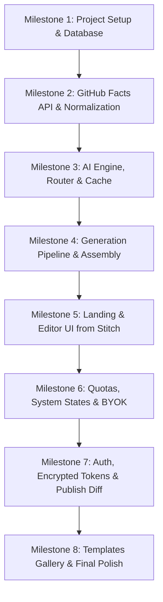

Viewed Design.md:1-150
Viewed Design.md:151-300
Viewed Design.md:301-436

Here is the in-depth analysis of [Design.md](file:///e:/Nuski/career%20develop/projects/Hello-md/Design.md), followed by the identified issues, best-practice recommendations, and a phased execution plan.

---

### Part 1: Critical Analysis & Recommended Fixes

While [Design.md](file:///e:/Nuski/career%20develop/projects/Hello-md/Design.md) is exceptionally well thought-out (grounding checks, deterministic assembly, token-conscious architecture, and strict security), there are **5 critical issues and inconsistencies** that must be corrected before writing code:

---

#### 1. Inaccessible Button Contrast & Invalid CSS Syntax in Section 3
* **The Problem:**
  1. Section 3 lists lines inside `:root { ... }` in descriptive pseudo-English (`Page background: #FAFAF8`, `Primary text: #171815`), which will crash CSS parsers if copied into `tokens.css`.
  2. Line 71 states: *"Primary is solid `--accent` with white text"*. However, `--accent` is **Electric Lime (`#C5F467`)**. White text (`#FFFFFF`) on `#C5F467` has an unusable contrast ratio of **~1.2:1** (violates WCAG AA 4.5:1, completely unreadable).
* **The Fix:**
  Stitch's own design specification for this project explicitly mandates:
  > *"Primary Accent (#C5F467): Electric lime. Paired strictly with #171815 text for optimal contrast."*
  
  Map `src/styles/tokens.css` to valid CSS custom properties with dark ink for primary button text:
  ```css
  :root {
    --bg-page: #FAFAF8;
    --surface: #F0F0EC;
    --border: #DEDFD8;
    --text-primary: #171815;
    --text-secondary: #65665F;
    --text-muted: #91928A;
    --accent: #C5F467;
    --accent-hover: #A8D94E;
    --focus-ring: #789A36;
    --status-success: #16A34A;
    --status-warning: #B45309;
    --status-error: #DC2626;

    --radius-control: 6px;
    --radius-panel: 8px;

    --font-ui: var(--font-inter), system-ui, sans-serif;
    --font-mono: var(--font-jetbrains), ui-monospace, monospace;
  }
  ```

---

#### 2. Non-Existent Groq Model Identifiers in Section 7 & 13
* **The Problem:**
  Line 402 lists:
  `GROQ_MODELS=openai/gpt-oss-120b,openai/gpt-oss-20b,qwen/qwen3.8-27b`
  Groq does not host models with these identifiers. Using them will result in instant `404 / 400 Model not found` errors.
* **The Fix:**
  Use actual, active high-speed Groq model IDs that support JSON mode and fast inference:
  ```bash
  GROQ_MODELS=llama-3.3-70b-versatile,llama-3.1-8b-instant
  ```
  And for Gemini:
  ```bash
  GEMINI_MODEL=gemini-1.5-flash
  ```

---

#### 3. React 19 vs. Core Dependencies (Next.js 15 Compatibility)
* **The Problem:**
  Next.js 15 defaults to React 19. Many essential libraries designated in your stack (`@uiw/react-codemirror`, `@dnd-kit/core`, `@dnd-kit/sortable`, and certain Radix primitives) have open peer-dependency conflicts with React 19.
* **The Fix:**
  Target **Next.js 14.2.x** with **React 18.3.x**. This guarantees rock-solid stability, zero peer-dependency gymnastics, and seamless SSR-bypass for CodeMirror and Drag-and-Drop.

---

#### 4. SSE Client Consumption for `POST /api/readmes`
* **The Problem:**
  The browser's native `new EventSource(url)` API **only supports HTTP `GET`** and cannot send a JSON request body (`{ login, tone, theme }`).
* **The Fix:**
  On the client, consume the SSE stream via `fetch()` with `response.body.getReader()` (or `@microsoft/fetch-event-source`). This supports `POST`, custom request headers (like Bring-Your-Own-Key), and request aborts.

---

#### 5. Clarify AI Output to Markdown Translation Layer
* **The Problem:**
  The AI outputs a structured JSON schema (`SectionsSchema`: `intro.headline`, `about.paragraphs`, `skills.groups`, etc.), while the database stores `readmes.sections[].markdown`.
* **The Fix:**
  Make `src/lib/assemble/formatSection.ts` an explicit, pure function that converts each key's validated JSON into its initial markdown representation. This keeps single-section regeneration (`/api/readmes/[id]/sections/[key]/regenerate`) isolated, deterministic, and clean.

---

#### Minor Correction:
* **Section Reference in Rule 2 (line 14):** Refers to *"section 13"* for milestones, but milestones are in **Section 14**.

---

### Part 2: Stitch Asset Verification

We inspected Stitch MCP and confirmed the matching project:
* **Project Name:** `projects/12204037378950961129` (**Hello-md Profile Generator**)
* **Available Screens for Reference:**
  1. `Hello-md — Generator & Landing` (`43ec9f67...`)
  2. `Hello-md — Editor Workspace` (`01be3e21...`)
  3. `Hello-md — Export Dialog` (`c05d8ef6...`)
  4. `Hello-md — Templates Gallery` (`d6f033fc...`)
  5. `Hello-md — System States` (`f7c83734...`)

Screenshots and HTML structures are ready to be fetched as visual blueprints during the UI milestone.

---

### Part 3: Phased Implementation Plan

Following the rule to **build one milestone at a time and stop/report after each**:



#### Milestone 1: Project Setup, Design Tokens, Env & Database
* **Scope:**
  * Initialize Next.js 14.2 (TypeScript, Tailwind CSS, App Router).
  * Setup `src/styles/tokens.css` and configure `tailwind.config.ts` with CSS variables.
  * Setup `src/lib/env.ts` with Zod validation.
  * Implement `src/lib/db/mongo.ts`, `collections.ts`, and `indexes.ts`.
  * Write and run `scripts/ensure-indexes.ts`.
* **Deliverable:** Bootable app, valid Mongo connection, indexes created, tokens rendering on a verification test route.

#### Milestone 2: GitHub Facts Ingestion & Normalization
* **Scope:**
  * Define `Facts` TypeScript type and Zod schema.
  * Implement `@octokit/graphql` query in `src/lib/github/query.ts`.
  * Implement `normalize.ts` (filtering forks, top 8 languages as percentages, top 6 repos by stars/recency, bio truncate).
  * Implement 1-hour TTL caching in `githubFacts` collection.
  * Create `GET /api/github/[login]`.
* **Deliverable:** Tested against 3 real GitHub usernames (high activity, low activity, zero public repos).

#### Milestone 3: Multi-Provider AI Engine (Groq + Gemini Fallback & Cache)
* **Scope:**
  * Implement `LLMProvider` interface (`src/lib/ai/types.ts`).
  * Implement Groq provider (using OpenAI-compatible endpoint with active model IDs) and Gemini provider (`@google/genai`).
  * Implement `src/lib/ai/router.ts`: 20s timeout, cooldown tracking in `providerState` on 429/5xx, automatic failover.
  * Implement `llmCache` (SHA-256 key with 7-day TTL).
* **Deliverable:** Test script proving automatic failover from Groq to Gemini and cache hits on repeated queries.

#### Milestone 4: Generation Pipeline, Validation & Deterministic Markdown Assembly
* **Scope:**
  * System prompt and tone directives (`src/lib/ai/prompt.ts`).
  * Zod `SectionsSchema` and validation pipeline (`validate.ts`) with strict grounding checks (ensuring no hallucinated repos, numbers, or languages).
  * Section formatter (`formatSection.ts`) and pure `assemble(sections, theme, facts)`.
  * Shields.io badge builder with safe URL encoding and color fallbacks (`badges.ts`).
  * SSE route `POST /api/readmes` emitting `fetching` -> `writing` -> `assembling` -> `done`.
* **Deliverable:** SSE pipeline generating 100% grounded Markdown for test users.

#### Milestone 5: UI Layer — Landing Page & Editor Workspace (Stitch Rebuild)
* **Scope:**
  * Fetch Stitch HTML and screenshots for Landing and Editor screens.
  * Rebuild Landing page: `@` username input, tone selector, template selector, generation counter, loading stepper.
  * Rebuild Editor page (`/editor/[id]`):
    * 48px top bar with autosave indicator.
    * Left column (280px): draggable section reordering via `@dnd-kit`, section enable/disable switches, single-section regenerate trigger.
    * Middle column: CodeMirror 6 markdown editor with live syncing to Zustand draft.
    * Right column: GitHub-styled markdown preview (`react-markdown`, `remark-gfm`, `rehype-sanitize`).
* **Deliverable:** Working interactive editor matching Stitch aesthetics.

#### Milestone 6: Quotas, System States & Bring-Your-Own-Key [COMPLETED]
* **Scope:**
  * Implement quota tracking in `src/lib/quota.ts` (3 generations/day, 0.25 for single section).
  * Implement anonymous owner cookie tracking (`src/lib/owner.ts`).
  * Support `x-groq-api-key` and `x-gemini-api-key` headers (unmetered, zero storage/logging).
  * Build system state banners from Stitch: AI busy countdown, quota exceeded, username not found.
* **Deliverable:** Quota depletion handling and unmetered BYOK bypass verified via `scripts/test-quota-byok.ts`. Live `/system-states` diagnostics page and client BYOK modal implemented.

#### Milestone 7: Auth.js, Token Encryption & GitHub Push with Diff [COMPLETED]
* **Scope:**
  * Configure NextAuth with GitHub provider (`read:user, public_repo`).
  * AES-256-GCM encryption/decryption in `src/lib/crypto.ts` for storing OAuth tokens.
  * Reassign anonymous drafts to user upon login.
  * Implement Export modal from Stitch: Copy Markdown, Download `README.md`, Push to GitHub.
  * Push to GitHub flow (`src/lib/github/publish.ts`): check repo existence, fetch current README SHA, compute unified diff, require explicit overwrite confirmation, commit.
* **Deliverable:** Verified with `scripts/test-milestone7.ts` (12 tests passed), `tsc --noEmit` (0 errors), `npm run lint` (clean), and `npm run build` (successful compilation). Production-ready Export dialog with live diff viewer and GitHub direct commit.

#### Milestone 8: Templates Gallery, Responsive Polish & Final Verification
* **Scope:**
  * Seed public templates in `templates` collection.
  * Build `/templates` page from Stitch design.
  * Implement responsive mobile layout (tabbed Edit / Preview switch).
  * Comprehensive linting, type checks (`noImplicitAny`), and accessibility audit.
* **Deliverable:** Complete, polished, production-ready app.

---

### Confirmation

Whenever you are ready, confirm this plan or let me know if you would like to adjust any model choices or token mappings before starting **Milestone 1**.